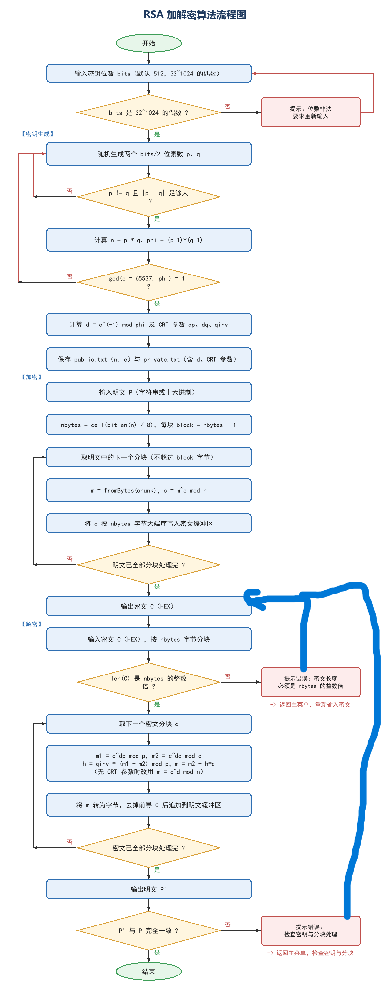

# 实验 3：RSA 加解密算法

这是一个面向学习的 RSA 教学实现，重点不依赖第三方密码库，而是用 C++ 标准库演示大整数运算、素数检测、密钥生成、RSA 加解密、CRT 加速和分块处理。

## 目录

| 路径 | 内容 |
| --- | --- |
| `rsa.cpp` | RSA 教学实现源码 |
| `assignment.txt` | 原始实验目标（已去除个人信息） |
| `docs/cpp-notes.md` | 编译、交互菜单和实现细节说明 |
| `image/` | RSA 流程图及对应的 Python 生成脚本 |

## 编译与运行

```powershell
g++ -O2 -static rsa.cpp -o rsa_cpp.exe
.\rsa_cpp.exe
```

程序提供密钥生成、加密、解密、查看密钥和自检等交互菜单。首次学习时建议按以下顺序阅读：

1. 大整数的表示与四则运算；
2. Miller-Rabin 素性检测；
3. 扩展欧几里得算法求模逆；
4. RSA 加密、解密和 CRT 参数；
5. 分块规则与明文长度边界。



## 安全说明

- 这是教学代码，不应直接用于生产系统。
- 真实工程应使用成熟密码库，并采用 OAEP 等安全填充方案。
- 私钥必须加密存储或放入硬件安全模块，不能像教学示例一样明文保存。
- 公开版本不包含私钥、公钥样本、编译产物和课程实验报告。

## 公开版本说明

为保护个人隐私，以下内容已主动排除：姓名、学号、实验报告、Word 文档、编译后的可执行文件和 RSA 私钥材料。
